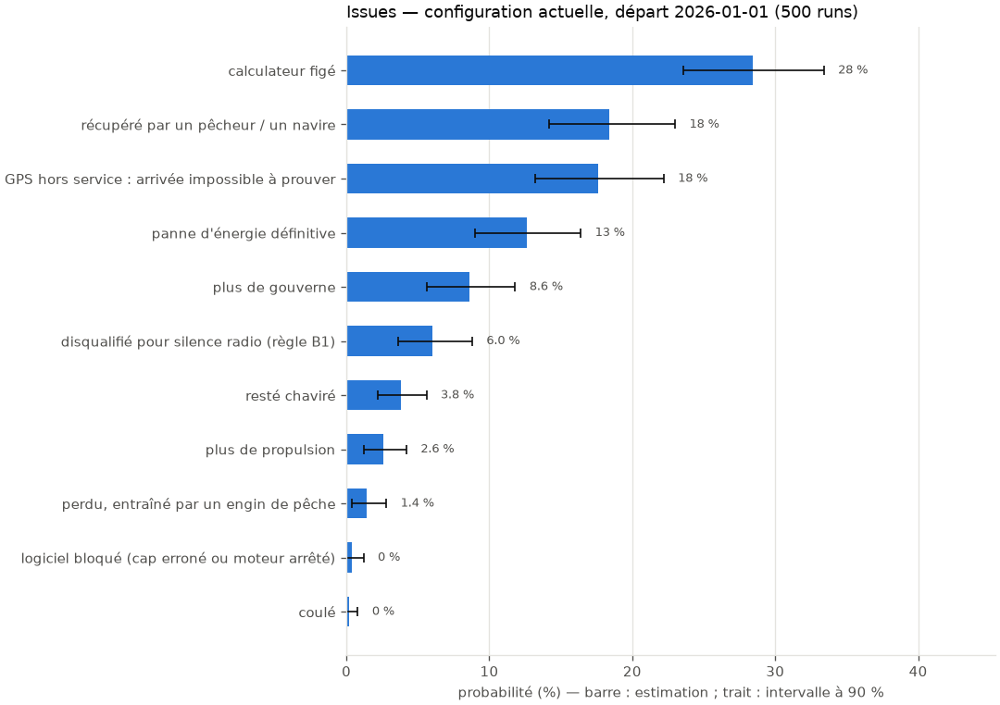
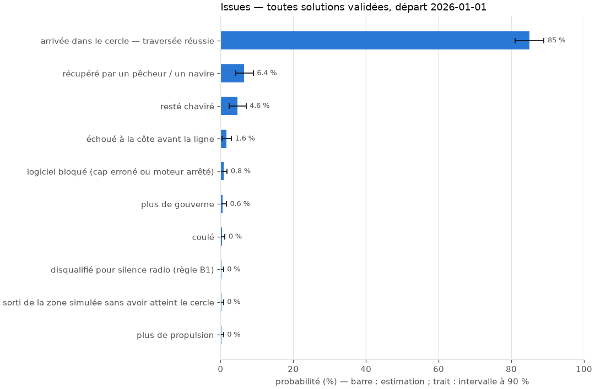
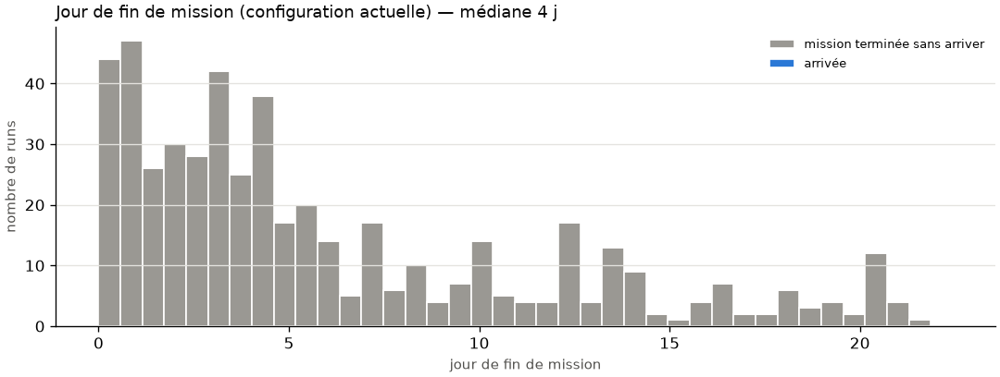
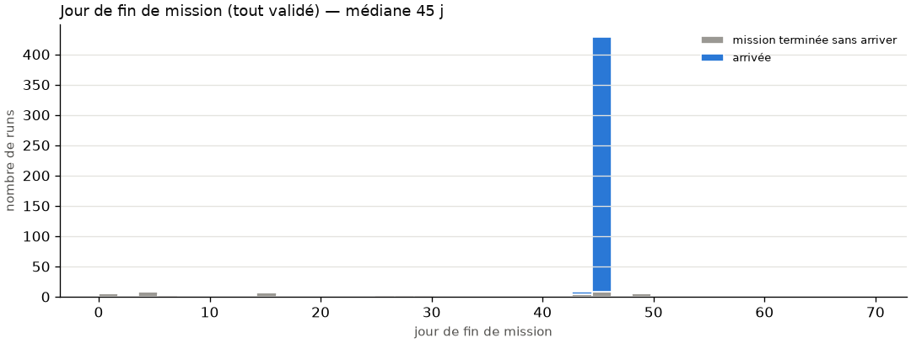
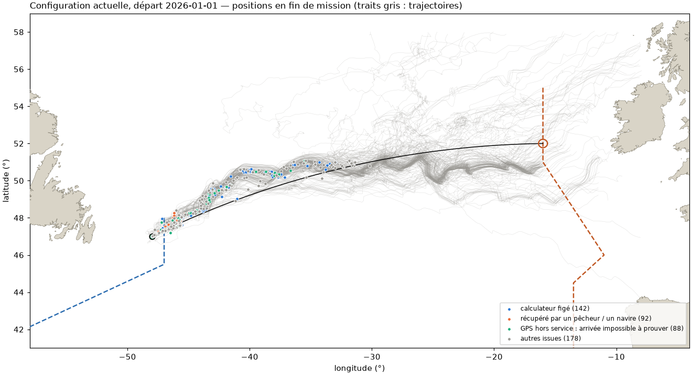
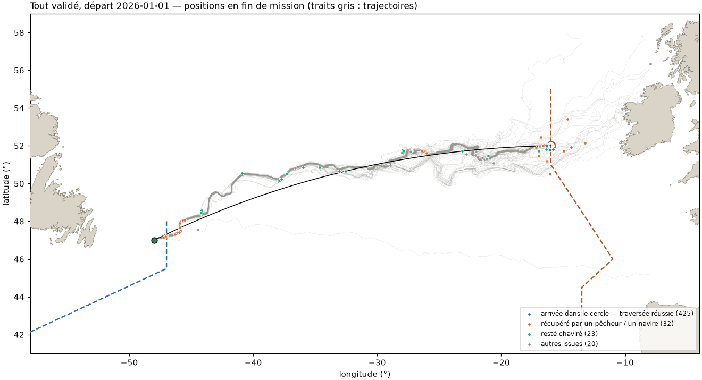
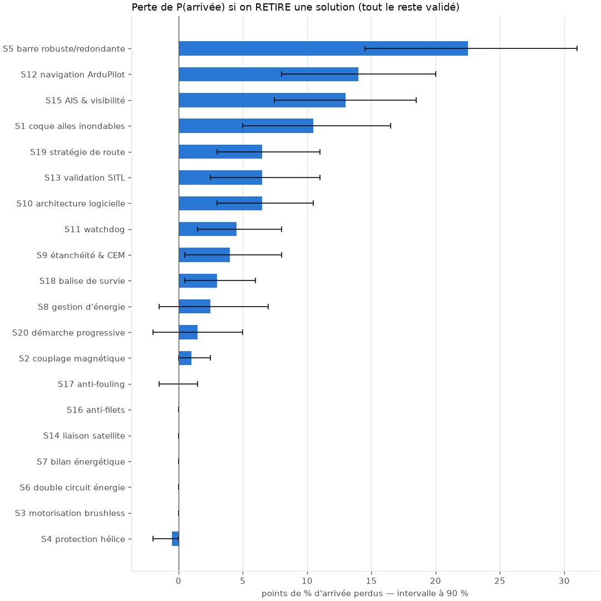
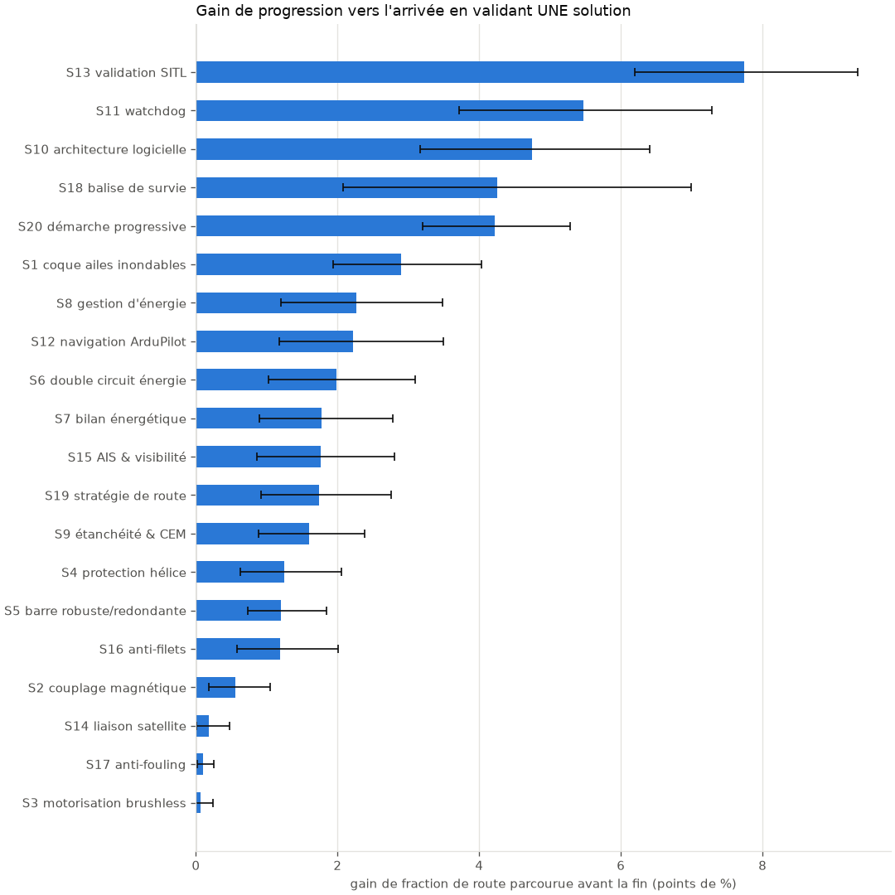
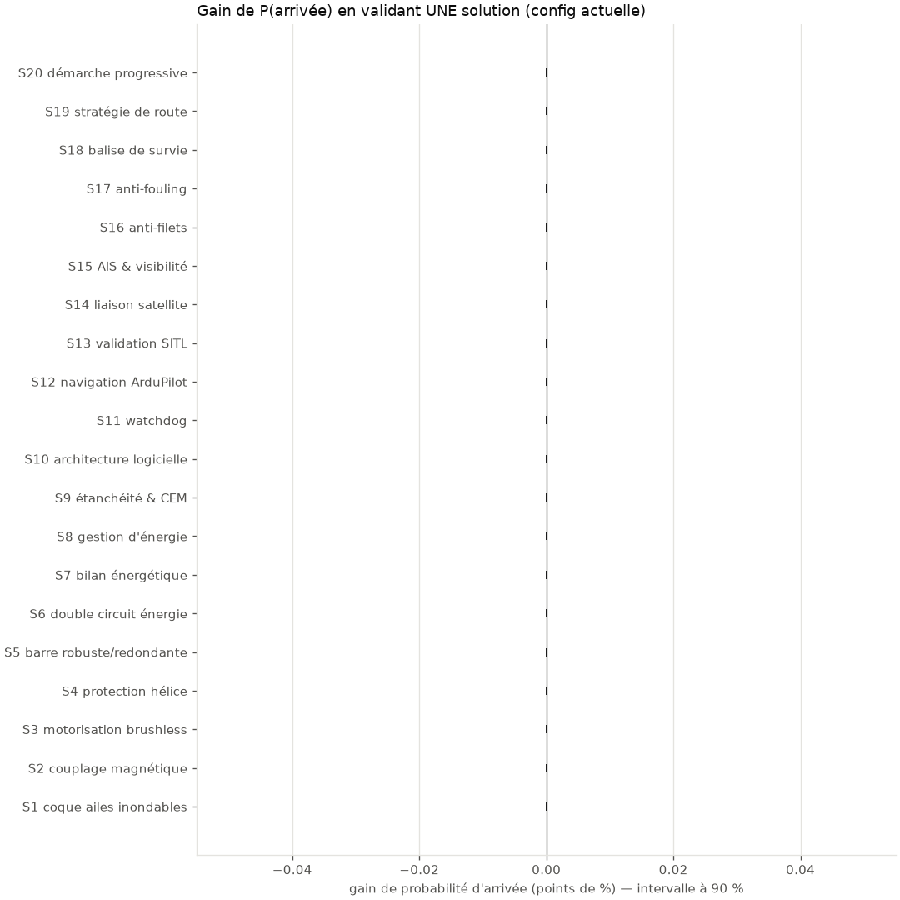
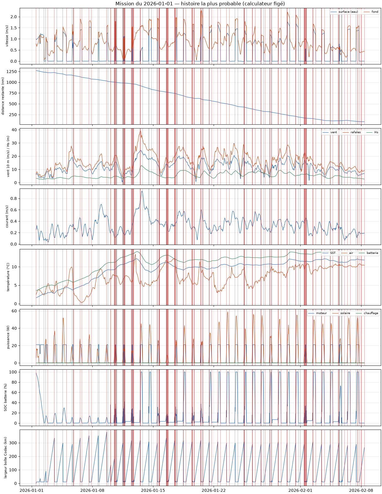

# Epi'Tortue — que se serait-il passé avec un largage le 2026-01-01 ?

> **Avertissement.** Ce rapport rejoue la météo, les vagues, les courants et l'activité de pêche *réels* de 2026 (ERA5, Open-Meteo Marine, Global Fishing Watch). Le bateau, ses pannes et ses rencontres sont *simulés* avec des taux incertains, calés sur un historique maigre (≈ 30 tentatives Microtransat). C'est un **scénario plausible et une statistique d'issues, pas une prédiction**. Chaque probabilité est donnée avec un intervalle à 90 % qui combine l'incertitude sur les paramètres (25 jeux tirés dans les priors) et le hasard des événements. Toutes les hypothèses chiffrées : `HYPOTHESES.md`.

Configuration : départ 47.0°N 48.0°W (≥ 40 nm avant la ligne de départ Ouest), cercle d'arrivée 52.0°N 16.0°W (25 km, ligne Est), orthodromie 1272 nm ; coque Testa (2,35 m, 50 kg, 273 Wc). Solutions en place : S1 = partielle.

## 1. Réponse courte

- Avec le bateau **tel qu'il est aujourd'hui** (presque toutes les solutions absentes), probabilité d'arriver : **0 % [0 % – 0 %]**. Issue la plus fréquente : **calculateur figé** (28 % des runs), fin médiane au jour 4.
- Avec **toutes les solutions S1–S20 validées**, même météo : **85 % [81 % – 89 %]**.
- Même bateau lancé le **2026-06-15** (fenêtre recommandée par la doc) : actuel 0.8 % [0 % – 2.4 %], tout validé 93 % [90 % – 96 %].

## 2. Statistique des issues (Monte-Carlo)

| Issue | Configuration actuelle | Tout validé |
|---|---|---|
| arrivée dans le cercle — traversée réussie | — | 85 % [81 % – 89 %] |
| calculateur figé | 28 % [24 % – 33 %] | — |
| récupéré par un pêcheur / un navire | 18 % [14 % – 23 %] | 6.4 % [4.2 % – 9.0 %] |
| GPS hors service : arrivée impossible à prouver | 18 % [13 % – 22 %] | — |
| panne d'énergie définitive | 13 % [9.0 % – 16 %] | — |
| plus de gouverne | 8.6 % [5.6 % – 12 %] | 0.6 % [0 % – 1.6 %] |
| disqualifié pour silence radio (règle B1) | 6.0 % [3.6 % – 8.8 %] | 0 % [0 % – 0.8 %] |
| resté chaviré | 3.8 % [2.2 % – 5.6 %] | 4.6 % [2.4 % – 7.0 %] |
| plus de propulsion | 2.6 % [1.2 % – 4.2 %] | 0 % [0 % – 0.8 %] |
| échoué à la côte avant la ligne | — | 1.6 % [0 % – 3.0 %] |
| perdu, entraîné par un engin de pêche | 1.4 % [0 % – 2.8 %] | — |
| logiciel bloqué (cap erroné ou moteur arrêté) | 0 % [0 % – 1.2 %] | 0.8 % [0 % – 1.8 %] |
| coulé | 0 % [0 % – 0.8 %] | 0 % [0 % – 1.2 %] |
| sorti de la zone simulée sans avoir atteint le cercle | — | 0 % [0 % – 0.8 %] |

## 3. Les tueurs de mission (configuration actuelle)

| Problème ayant mis fin à la mission | Probabilité |
|---|---|
| P17 Failsafe dangereux, bugs temporels, gel | 24 % [20 % – 29 %] |
| P24 Filets et cordages (pêche) | 20 % [16 % – 24 %] |
| P18 Navigation (capteurs, données corrompues) | 17 % [13 % – 22 %] |
| P10 Production électrique redondante | 13 % [9.0 % – 16 %] |
| P8 Redondance de la gouverne | 8.6 % [5.6 % – 12 %] |
| P12 Gestion logicielle de l'énergie | 5.8 % [3.4 % – 8.6 %] |
| P13 Étanchéité de l'électronique | 5.0 % [3.0 % – 7.2 %] |
| P16 Logiciel face à l'imprévu | 3.2 % [1.4 % – 5.2 %] |
| P2 Auto-redressement | 2.2 % [0.8 % – 3.6 %] |
| P4 Propulsion économe et fiable (moteur) | 0.6 % [0 % – 1.4 %] |
| P14 Corrosion et vibrations | 0 % [0 % – 0.8 %] |
| P20 Perte de télémétrie | 0 % [0 % – 0.8 %] |
| P22 Être vu (collision) | 0 % [0 % – 0.8 %] |

## 4. Tableau P1–P28 : avec et sans la solution principale

« Avec » = même Monte-Carlo (200 runs, mêmes graines) où seule la solution principale du problème passe à « validée ». Intervalles à 90 %.

| Problème | Solution principale | P(survient) sans | P(survient) avec | P(met fin) sans | P(met fin) avec |
|---|---|---|---|---|---|
| **P1** Survie de la coque | S1 | 1.0 % [0 % – 3.0 %] | 1.0 % [0 % – 3.0 %] | 0 % [0 % – 0 %] | 0 % [0 % – 0 %] |
| **P2** Auto-redressement | S1 | 16 % [10 % – 24 %] | 22 % [16 % – 30 %] | 1.5 % [0 % – 3.5 %] | 0 % [0 % – 2.0 %] |
| **P3** Ouvertures (étanchéité des trappes) | S1 | 10 % [6.0 % – 16 %] | 3.0 % [0 % – 6.0 %] | 0 % [0 % – 0 %] | 0 % [0 % – 0 %] |
| **P4** Propulsion économe et fiable (moteur) | S3 | 1.0 % [0 % – 2.5 %] | 0 % [0 % – 0 %] | 1.0 % [0 % – 2.5 %] | 0 % [0 % – 0 %] |
| **P5** Étanchéité d'arbre | S2 | 2.0 % [0 % – 4.5 %] | 0 % [0 % – 0 %] | 0 % [0 % – 0 %] | 0 % [0 % – 0 %] |
| **P6** Protection de l'hélice | S4 | 5.5 % [2.5 % – 9.5 %] | 0 % [0 % – 2.0 %] | 0 % [0 % – 0 %] | 0 % [0 % – 0 %] |
| **P7** Usure de l'actionneur de barre | S5 | 7.0 % [3.5 % – 12 %] | 0 % [0 % – 0 %] | 0 % [0 % – 0 %] | 0 % [0 % – 0 %] |
| **P8** Redondance de la gouverne | S5 | 7.0 % [3.5 % – 12 %] | 0 % [0 % – 0 %] | 7.0 % [3.5 % – 12 %] | 0 % [0 % – 0 %] |
| **P9** Remontée au vent / weaving | S5 | 100 % [100 % – 100 %] | 0 % [0 % – 0 %] | 0 % [0 % – 0 %] | 0 % [0 % – 0 %] |
| **P10** Production électrique redondante | S7 | 12 % [7.0 % – 18 %] | 3.0 % [0 % – 6.0 %] | 12 % [7.0 % – 18 %] | 3.0 % [0 % – 6.0 %] |
| **P11** Stockage (batterie) | S6 | 3.0 % [0 % – 6.0 %] | 1.0 % [0 % – 3.0 %] | 0 % [0 % – 0 %] | 0 % [0 % – 0 %] |
| **P12** Gestion logicielle de l'énergie | S8 | 85 % [80 % – 90 %] | 13 % [8.0 % – 18 %] | 5.5 % [1.5 % – 10 %] | 0 % [0 % – 0 %] |
| **P13** Étanchéité de l'électronique | S9 | 12 % [6.5 % – 18 %] | 2.0 % [0 % – 4.5 %] | 4.0 % [1.5 % – 7.0 %] | 1.0 % [0 % – 3.0 %] |
| **P14** Corrosion et vibrations | S9 | 0 % [0 % – 2.0 %] | 0 % [0 % – 0 %] | 0 % [0 % – 0 %] | 0 % [0 % – 0 %] |
| **P15** Compatibilité électromagnétique | S9 | 54 % [46 % – 62 %] | 0 % [0 % – 0 %] | 0 % [0 % – 0 %] | 0 % [0 % – 0 %] |
| **P16** Logiciel face à l'imprévu | S10 | 12 % [6.5 % – 17 %] | 2.5 % [0 % – 5.0 %] | 4.0 % [1.0 % – 7.5 %] | 1.0 % [0 % – 3.0 %] |
| **P17** Failsafe dangereux, bugs temporels, gel | S10 | 33 % [26 % – 40 %] | 18 % [12 % – 24 %] | 28 % [20 % – 36 %] | 6.0 % [2.5 % – 10 %] |
| **P18** Navigation (capteurs, données corrompues) | S12 | 7.5 % [3.5 % – 12 %] | 2.5 % [0 % – 5.5 %] | 18 % [12 % – 24 %] | 6.5 % [3.0 % – 10 %] |
| **P19** Validation insuffisante | S13 | effet global : × taux des domaines B–G | | | |
| **P20** Perte de télémétrie | S14 | 12 % [7.5 % – 18 %] | 0 % [0 % – 0 %] | 0 % [0 % – 0 %] | 0 % [0 % – 0 %] |
| **P21** Réception de données | S14 | 5.0 % [2.0 % – 9.0 %] | 0 % [0 % – 0 %] | 0 % [0 % – 0 %] | 0 % [0 % – 0 %] |
| **P22** Être vu (collision) | S15 | 0 % [0 % – 0 %] | 0 % [0 % – 0 %] | 0 % [0 % – 0 %] | 0 % [0 % – 0 %] |
| **P23** Rester identifiable | S15 | 3.5 % [1.0 % – 7.0 %] | 8.5 % [4.5 % – 13 %] | 0 % [0 % – 0 %] | 0 % [0 % – 0 %] |
| **P24** Filets et cordages (pêche) | S1 | 38 % [30 % – 46 %] | 39 % [30 % – 48 %] | 20 % [13 % – 26 %] | 11 % [6.5 % – 16 %] |
| **P25** Sargasses et biofouling | S17 | 0 % [0 % – 0 %] | 0 % [0 % – 0 %] | 0 % [0 % – 0 %] | 0 % [0 % – 0 %] |
| **P26** Faune marine | S1 | 0 % [0 % – 0 %] | 0 % [0 % – 0 %] | 0 % [0 % – 0 %] | 0 % [0 % – 0 %] |
| **P27** Pas de perte silencieuse | S18 | 20 % [14 % – 27 %] | 0 % [0 % – 0 %] | 0 % [0 % – 0 %] | 0 % [0 % – 0 %] |
| **P28** Flottabilité | S18 | 0 % [0 % – 0 %] | 0 % [0 % – 1.5 %] | 0 % [0 % – 0 %] | 0 % [0 % – 0 %] |

## 5. Valeur de chaque solution (pour prioriser)

Deux lectures complémentaires, à météo et graines identiques :

- **Ajouter une solution** au bateau actuel : quand presque tout manque, une solution seule change rarement l'arrivée ; la **progression** (fraction de route faite avant la fin) et la **durée de vie** en mer montrent mieux ce qui retarde la fin.
- **Retirer une solution** d'un bateau où tout est validé : mesure ce dont on ne peut pas se passer.

| Solution | + Sx : gain P(arrivée) | + Sx : gain de progression | + Sx : gain de durée (≤ 120 j) | Tout validé − Sx : perte P(arrivée) |
|---|---|---|---|---|
| S5 barre robuste/redondante | 0 % [0 % – 0 %] | 1.2 % [0.7 % – 1.8 %] | 0 % [0 % – 0 %] | 22 % [14 % – 31 %] |
| S12 navigation ArduPilot | 0 % [0 % – 0 %] | 2.2 % [1.2 % – 3.5 %] | 0.7 % [0 % – 1.0 %] | 14 % [8.0 % – 20 %] |
| S15 AIS & visibilité | 0 % [0 % – 0 %] | 1.8 % [0.9 % – 2.8 %] | 0.7 % [0 % – 1.1 %] | 13 % [7.5 % – 18 %] |
| S1 coque ailes inondables | 0 % [0 % – 0 %] | 2.9 % [1.9 % – 4.0 %] | 1.0 % [0.7 % – 1.4 %] | 10 % [5.0 % – 16 %] |
| S19 stratégie de route | 0 % [0 % – 0 %] | 1.7 % [0.9 % – 2.8 %] | 0.6 % [0 % – 0.9 %] | 6.5 % [3.0 % – 11 %] |
| S10 architecture logicielle | 0 % [0 % – 0 %] | 4.8 % [3.2 % – 6.4 %] | 1.5 % [1.0 % – 2.0 %] | 6.5 % [3.0 % – 10 %] |
| S13 validation SITL | 0 % [0 % – 0 %] | 7.7 % [6.2 % – 9.3 %] | 2.5 % [2.0 % – 3.0 %] | 6.5 % [2.5 % – 11 %] |
| S11 watchdog | 0 % [0 % – 0 %] | 5.5 % [3.7 % – 7.3 %] | 1.8 % [1.3 % – 2.4 %] | 4.5 % [1.5 % – 8.0 %] |
| S9 étanchéité & CEM | 0 % [0 % – 0 %] | 1.6 % [0.9 % – 2.4 %] | 0 % [0 % – 0.7 %] | 4.0 % [0 % – 8.0 %] |
| S18 balise de survie | 0 % [0 % – 0 %] | 4.3 % [2.1 % – 7.0 %] | 1.6 % [0.7 % – 2.7 %] | 3.0 % [0 % – 6.0 %] |
| S8 gestion d'énergie | 0 % [0 % – 0 %] | 2.3 % [1.2 % – 3.5 %] | 1.1 % [0.7 % – 1.6 %] | 2.5 % [-2 % – 7.0 %] |
| S20 démarche progressive | 0 % [0 % – 0 %] | 4.2 % [3.2 % – 5.3 %] | 1.3 % [1.0 % – 1.6 %] | 1.5 % [-2 % – 5.0 %] |
| S2 couplage magnétique | 0 % [0 % – 0 %] | 0.6 % [0 % – 1.0 %] | 0 % [0 % – 0 %] | 1.0 % [0 % – 2.5 %] |
| S6 double circuit énergie | 0 % [0 % – 0 %] | 2.0 % [1.0 % – 3.1 %] | 0.7 % [0 % – 1.1 %] | 0 % [0 % – 0 %] |
| S3 motorisation brushless | 0 % [0 % – 0 %] | 0 % [0 % – 0 %] | 0 % [0 % – 0 %] | 0 % [0 % – 0 %] |
| S7 bilan énergétique | 0 % [0 % – 0 %] | 1.8 % [0.9 % – 2.8 %] | 0.6 % [0 % – 1.0 %] | 0 % [0 % – 0 %] |
| S14 liaison satellite | 0 % [0 % – 0 %] | 0 % [0 % – 0 %] | 0 % [0 % – 0 %] | 0 % [0 % – 0 %] |
| S16 anti-filets | 0 % [0 % – 0 %] | 1.2 % [0.6 % – 2.0 %] | 0 % [0 % – 0.7 %] | 0 % [0 % – 0 %] |
| S17 anti-fouling | 0 % [0 % – 0 %] | 0 % [0 % – 0 %] | 0 % [0 % – 0 %] | 0 % [-2 % – 1.5 %] |
| S4 protection hélice | 0 % [0 % – 0 %] | 1.2 % [0.6 % – 2.1 %] | 0 % [0 % – 0.7 %] | -0 % [-2 % – 0 %] |

## 6. L'histoire la plus probable

Run médian de l'issue la plus fréquente du Monte-Carlo (« calculateur figé », 28 % des 500 runs).

- Journal de bord : [histoire_probable_20260101_journal.md](histoire_probable_20260101_journal.md)
- Carte interactive : [histoire_probable_20260101_carte.html](histoire_probable_20260101_carte.html)
- Courbes : 

**Même histoire, toutes solutions validées** : arrivée dans le cercle — traversée réussie au jour 45 — [journal](histoire_toutvalide_20260101_journal.md), [carte](histoire_toutvalide_20260101_carte.html).

## 7. « Et si je ne le résous pas ? » — un récit par problème

- [P1 Survie de la coque](histoires_20260101/P1.md)
- [P2 Auto-redressement](histoires_20260101/P2.md)
- [P3 Ouvertures (étanchéité des trappes)](histoires_20260101/P3.md)
- [P4 Propulsion économe et fiable (moteur)](histoires_20260101/P4.md)
- [P5 Étanchéité d'arbre](histoires_20260101/P5.md)
- [P6 Protection de l'hélice](histoires_20260101/P6.md)
- [P7 Usure de l'actionneur de barre](histoires_20260101/P7.md)
- [P8 Redondance de la gouverne](histoires_20260101/P8.md)
- [P9 Remontée au vent / weaving](histoires_20260101/P9.md)
- [P10 Production électrique redondante](histoires_20260101/P10.md)
- [P11 Stockage (batterie)](histoires_20260101/P11.md)
- [P12 Gestion logicielle de l'énergie](histoires_20260101/P12.md)
- [P13 Étanchéité de l'électronique](histoires_20260101/P13.md)
- [P14 Corrosion et vibrations](histoires_20260101/P14.md)
- [P15 Compatibilité électromagnétique](histoires_20260101/P15.md)
- [P16 Logiciel face à l'imprévu](histoires_20260101/P16.md)
- [P17 Failsafe dangereux, bugs temporels, gel](histoires_20260101/P17.md)
- [P18 Navigation (capteurs, données corrompues)](histoires_20260101/P18.md)
- [P19 Validation insuffisante](histoires_20260101/P19.md)
- [P20 Perte de télémétrie](histoires_20260101/P20.md)
- [P21 Réception de données](histoires_20260101/P21.md)
- [P22 Être vu (collision)](histoires_20260101/P22.md)
- [P23 Rester identifiable](histoires_20260101/P23.md)
- [P24 Filets et cordages (pêche)](histoires_20260101/P24.md)
- [P25 Sargasses et biofouling](histoires_20260101/P25.md)
- [P26 Faune marine](histoires_20260101/P26.md)
- [P27 Pas de perte silencieuse](histoires_20260101/P27.md)
- [P28 Flottabilité](histoires_20260101/P28.md)

## 8. Chauffer la batterie ? (question B)

Voir [chauffage_20260101.md](chauffage_20260101.md) (coût, gain et verdict par scénario thermique).

## 8b. Enseignements physiques (sans pannes, S8 validée)

- **Le piège des derniers milles.** Près de l'Irlande, le vent et le courant portent au nord-est. Un bateau qui arrive un peu tard ou un peu au nord du cercle est entraîné le long du plateau et ne peut pas remonter au vent avec l'énergie d'hiver : il reste bloqué des semaines. Sensibilité au centre du cercle d'arrivée (sur la ligne Est, 16°W ; 6 largages décalés de 6 h) :

| Centre du cercle | Arrivées | Jour de fin (médiane) |
|---|---|---|
| 51.2°N 16°W | 6/6 | 39 |
| 52.0°N 16°W | 6/6 | 43 |
| 53.0°N 16°W | 0/6 | 87 |
| 54.0°N 16°W | 5/6 | 47 |

  → l'autopilote vise désormais par défaut le **bord sud du cercle, décalé en amont de la dérive estimée** (stratégie `navigation.approche.strategie: bord_sud`, H75) ; l'ancienne stratégie (viser le centre) reste disponible. Effet mesuré : section 11.
- **En hiver, l'électronique mange l'énergie.** La production solaire réelle de janvier (≈ 5 W en moyenne, ≈ 130 Wh/j) couvre à peine les 114 Wh/j de consommation de bord : il reste quelques watts pour le moteur. La gestion d'énergie validée (S8) prévoit donc le solaire des 24 h suivantes et ne garde en réserve que l'énergie de l'électronique de nuit ; quand le soleil manque, elle met le bateau en veille profonde la nuit (H74). Effet mesuré : section 11.

## 9. Contrôle de calibration

Toutes solutions « partielles » (≈ flotte historique, hypothèse C1), départ d'été, 200 runs :

- fin par captures (P23/P24) : 16 % [12 % – 22 %]
- fin par logiciel (P16–P18) : 28 % [22 % – 35 %]
- fin par mécanique (P4–P8) : 6.5 % [3.0 % – 10 %]
- arrivée : 39 % [32 % – 46 %]
- historique cité (≥ 30 tentatives) : captures 9–10 (≈ 32 %), logiciel 8–9 (≈ 28 %), mécanique 3–4 (≈ 12 %), 1 réussite (≈ 3 %), aucun bateau motorisé arrivé. L'accord n'est qu'indicatif : les tentatives historiques ont des routes, saisons et durées différentes.

## 10. Méthode et limites

- Météo ERA5 et vagues/courants Open-Meteo réels, grille 1°, interpolés le long de la trajectoire ; les extrêmes locaux (fronts, tourbillons) sont lissés.
- Bateau : bilan de forces 2D (carène Testa, résistance ajoutée par les vagues, fardage, dérive latérale sans quille) ; énergie solaire réelle (ERA5 direct + diffus, pont plat, IAM) ; batterie LiFePO4 thermique.
- Navigation : estimateur ensembliste Codac garanti (vérifié par test : la vraie position reste dans la boîte, hors sauts GPS sous le seuil de détection et pannes de capteur non encore détectées).
- Monte-Carlo : 500 runs (référence), 200 par contrefactuel, pas de 30 min, nombres aléatoires communs ; intervalles par bootstrap hiérarchique.
- Le chavirage dépend maintenant de la cambrure des vagues (déferlement) et de la stabilité de la coque (H71) ; ses seuils « face ou dos à la vague » et les taux sans historique (P1, P3, P10, P11, P13, P14, P20, P21, P26) restent des jugements : ce sont eux qu'il faut challenger en premier.
- Une seule année de météo (2026) sert au rapport principal ; la section 11 montre ce que change la météo d'autres années.

## 11. Corrections du modèle (novembre 2026) : effet mesuré

Chaque correction garde l'ancien comportement comme option (HYPOTHESES.md, H71–H78). Elles sont activées une à une, sur les mêmes graines et les mêmes jeux de paramètres, pour mesurer ce que chacune change aux résultats clés. Les écarts plus petits que les intervalles à 90 % ne sont pas significatifs.

### Effet de chaque correction (python main.py effets)

Corrections activées une à une, en cumulant, sur les mêmes graines (200 runs par configuration, 100 pour le classement des solutions). Intervalles à 90 %. Une ligne se lit par rapport à la précédente. Les points 4 (pêche), 7 (années de météo) et 8 (icebergs) ne changent pas le modèle par défaut : ils sont traités dans le rapport.

| Étape | Hiver : actuel | Hiver : tout validé | Été : actuel | Été : tout validé | Hiver, tout validé : resté chaviré | Hiver, tout validé : jour de fin médian |
|---|---|---|---|---|---|---|
| Ancien modèle (avant corrections) | 0 % [0 % – 0 %] | 74 % [66 % – 80 %] | 0 % [0 % – 1.5 %] | 94 % [90 % – 98 %] | 12 % [7.0 % – 18 %] | 48 |
| 1. Chavirage lié à la cambrure des vagues [H71] | 0 % [0 % – 0 %] | 80 % [74 % – 86 %] | 0 % [0 % – 1.5 %] | 92 % [88 % – 96 %] | 5.0 % [2.0 % – 8.5 %] | 48 |
| 2. P9 : lacets (pilotage) séparés de la résistance des vagues [H72] | 0 % [0 % – 0 %] | 84 % [78 % – 88 %] | 0 % [0 % – 1.5 %] | 92 % [88 % – 96 %] | 5.0 % [2.0 % – 8.5 %] | 46 |
| 3. Gestion d'énergie S8 par prévision solaire [H74] | 0 % [0 % – 0 %] | 84 % [78 % – 90 %] | 0 % [0 % – 1.5 %] | 93 % [89 % – 96 %] | 4.5 % [1.5 % – 8.0 %] | 45 |
| 5. Approche par le bord sud du cercle [H75] | 0 % [0 % – 0 %] | 84 % [78 % – 89 %] | 0 % [0 % – 1.5 %] | 93 % [89 % – 96 %] | 5.0 % [2.0 % – 8.5 %] | 46 |
| 6. Marge de saut sur le fix GPS [H34] | 0 % [0 % – 0 %] | 84 % [78 % – 89 %] | 0 % [0 % – 1.5 %] | 93 % [89 % – 96 %] | 5.0 % [2.0 % – 8.5 %] | 46 |
| 9. Grille météo à 1° (au lieu de 2°) | 0 % [0 % – 0 %] | 84 % [78 % – 89 %] | 0 % [0 % – 1.5 %] | 93 % [89 % – 96 %] | 5.0 % [2.0 % – 8.5 %] | 45 |

#### Classement des solutions (perte de P(arrivée) si on retire Sx d'un bateau tout validé)

Les cinq premières à chaque étape, avec la perte en points de probabilité.

| Étape | 1 | 2 | 3 | 4 | 5 | Rang et valeur de S5 | Rang et valeur de S8 |
|---|---|---|---|---|---|---|---|
| Ancien modèle (avant corrections) | S5 (75 %) | S1 (25 %) | S12 (22 %) | S10 (14 %) | S13 (13 %) | 1ᵉ (75 %) | 19ᵉ (-2 %) |
| 1. Chavirage lié à la cambrure des vagues [H71] | S5 (81 %) | S12 (23 %) | S10 (14 %) | S13 (12 %) | S1 (9.0 %) | 1ᵉ (81 %) | 19ᵉ (-2 %) |
| 2. P9 : lacets (pilotage) séparés de la résistance des vagues [H72] | S5 (43 %) | S12 (24 %) | S13 (16 %) | S10 (13 %) | S1 (10 %) | 1ᵉ (43 %) | 10ᵉ (4.0 %) |
| 3. Gestion d'énergie S8 par prévision solaire [H74] | S5 (26 %) | S12 (16 %) | S1 (10 %) | S13 (9.0 %) | S10 (7.0 %) | 1ᵉ (26 %) | 7ᵉ (6.0 %) |
| 5. Approche par le bord sud du cercle [H75] | S5 (31 %) | S12 (13 %) | S1 (10 %) | S15 (10 %) | S13 (8.0 %) | 1ᵉ (31 %) | 8ᵉ (6.0 %) |
| 6. Marge de saut sur le fix GPS [H34] | S5 (31 %) | S12 (14 %) | S15 (11 %) | S1 (10 %) | S13 (8.0 %) | 1ᵉ (31 %) | 8ᵉ (6.0 %) |
| 9. Grille météo à 1° (au lieu de 2°) | S5 (26 %) | S15 (17 %) | S12 (15 %) | S1 (11 %) | S8 (8.0 %) | 1ᵉ (26 %) | 5ᵉ (8.0 %) |

#### Gestion d'énergie S8 : politiques comparées (sans pannes, navigation parfaite)

12 largages décalés de 12 h ; « naïve » = S8 absente (moteur à fond jusqu'à la coupure du BMS). « prevision » = prévision parfaite (rayonnement réel des 24 h suivantes) ; « prevision_persistance » = ce que le bateau peut prévoir seul (demain comme aujourd'hui). Critère : la politique validée doit faire au moins aussi bien que la naïve (arrivées, puis distance restante).

**Départ 2026-01-01 (hiver)**

| Politique | Arrivées | Jour de fin (médiane) | Reste à parcourir au jour 30 (nm, moyenne) | Énergie moteur (Wh) | Black-out par mission |
|---|---|---|---|---|---|
| naive | 0/12 | 21 | 175 | 51403 | 86.9 |
| regulation | 12/12 | 41 | 235 | 4045 | 0.0 |
| prevision | 12/12 | 41 | 186 | 5990 | 0.0 |
| prevision_persistance | 12/12 | 41 | 181 | 5795 | 0.0 |

**Départ 2026-06-15 (été)**

| Politique | Arrivées | Jour de fin (médiane) | Reste à parcourir au jour 30 (nm, moyenne) | Énergie moteur (Wh) | Black-out par mission |
|---|---|---|---|---|---|
| naive | 12/12 | 19 | 0 | 9164 | 2.7 |
| regulation | 12/12 | 19 | 0 | 10796 | 0.0 |
| prevision | 12/12 | 18 | 0 | 11245 | 0.0 |
| prevision_persistance | 12/12 | 18 | 0 | 11214 | 0.0 |

### Captures par les pêcheurs : effet de la route (python main.py peche)

Scénario « historique » (toutes solutions partielles, départ le 2026-06-15), 200 runs par route, mêmes graines. Route côtière : départ 47.6°N 52.4°W (large de St John's, Terre-Neuve), à travers les Grands Bancs. Le taux de rencontre reste calé sur la densité de pêche de la route de la mission (H45, H73). Intervalles à 90 %.

| Route | Fin par capture (P23/P24) | Au moins une rencontre de pêche | Jour de fin médian |
|---|---|---|---|
| route mission | 16 % [12 % – 22 %] | 40 % [33 % – 48 %] | 19 |
| route cotiere | 78 % [70 % – 85 %] | 98 % [96 % – 100 %] | 1 |

Écart dû à la route (côtière − mission, runs appariés) : 62 % [52 % – 70 %].

Historique cité : 9–10 captures sur ≈ 30 tentatives (≈ 32 %). Si la route côtière s'en approche, l'écart venait de la route ; l'écart restant est porté par `rencontres.facteur_rencontre` (risks.yaml, défaut 1, H73).

**Conclusion.** La route suffit à expliquer l'écart, et au-delà : partir au milieu des Grands Bancs fait passer les captures de 16 % à 78 % (fin médiane au jour 1). Les tentatives historiques sont entre les deux (départs plus ou moins proches de la côte, saisons différentes) : leurs ≈ 32 % sont compatibles avec le modèle. Aucun écart inexpliqué ne justifie de changer `rencontres.facteur_rencontre`, qui reste à 1. Pour Epi'Tortue, cela confirme l'intérêt d'un largage au large (H01) plutôt que depuis la côte.

### Plusieurs années de météo (python main.py annees)

Même jour de départ, mêmes jeux de paramètres et mêmes graines chaque année (200 runs par année et par configuration), grille météo à 2° pour toutes les années. Intervalles à 90 % (bootstrap sur les jeux de paramètres puis sur les runs).

| Départ | Configuration | 2024 | 2025 | 2026 |
|---|---|---|---|---|
| hiver | actuel | 0 % [0 % – 0 %] | 0 % [0 % – 0 %] | 0 % [0 % – 0 %] |
| hiver | tout valide | 78 % [72 % – 84 %] | 65 % [58 % – 72 %] | 84 % [78 % – 89 %] |
| ete | actuel | 0 % [0 % – 1.5 %] | 0 % [0 % – 1.5 %] | 0 % [0 % – 1.5 %] |
| ete | tout valide | 94 % [90 % – 98 %] | 94 % [90 % – 98 %] | 93 % [89 % – 96 %] |

#### D'où vient l'incertitude ?

Écarts-types de P(arrivée), en points de pourcentage. **Météo** : différence d'une année à l'autre ; **modèle** : différence d'un jeu de paramètres à l'autre (taux de pannes et de rencontres incertains) ; **hasard** : tirage des pannes à météo et paramètres fixés (il se moyenne sur les runs et ne pèse pas sur l'estimation). Les deux premiers sont corrigés du bruit d'échantillonnage.

| Départ, configuration | P(arrivée), toutes années | Météo | Modèle | Rapport météo / modèle |
|---|---|---|---|---|
| hiver actuel | 0 % | ± 0.0 | ± 0.0 | inf |
| hiver tout valide | 75 % | ± 8.9 | ± 6.6 | 1.35 |
| ete actuel | 0 % | ± 0.0 | ± 2.0 | 0.00 |
| ete tout valide | 94 % | ± 0.0 | ± 5.2 | 0.00 |

Lecture : si la colonne « météo » domine, une seule année de données ne suffit pas à conclure, même avec un modèle parfait ; si c'est le « modèle », il faut mieux connaître les taux de pannes (essais, retours d'expérience) avant de gagner en précision. Trois années ne donnent qu'une estimation grossière de la variabilité météo : à lire comme un ordre de grandeur.

### Icebergs

Module désactivé par défaut : les observations 2026 de l'International Ice Patrol ne sont pas en libre accès, et aucune donnée n'est inventée (H08, H77). Le README donne le format de `data/icebergs.csv` et la façon d'obtenir les données (NSIDC G00807, compte Earthdata).

### Mode d'arrondi (H78)

`import codac` laissait le processeur en arrondi vers le haut pour tout le simulateur, mais seulement à partir de son premier import dans chaque processus : le premier run de chaque processus du Monte-Carlo était calculé un peu différemment des autres. Le simulateur calcule désormais au plus proche, et vers le haut seulement pendant les calculs Codac. Effet physique nul ; résultats reproductibles quel que soit l'ordre d'exécution des runs.

## 12. Calcul

- Durée totale : 7.9 min (14 processus) ; monte carlo 438 s, figures 6 s, histoire 5 s, recits 7 s, chauffage cercles 15 s.

### Optimisations (résultats identiques au bit près)

Règle suivie : **résultats identiques au bit près**. La trajectoire est chaotique (un écart d'un bit sur une
vitesse finit par décaler un événement d'un pas de temps, donc l'issue de certaines missions) : une
approximation, même minuscule, rendrait impossible la comparaison des versions sur les mêmes graines. Chaque
optimisation est vérifiée par `tests/test_non_regression.py` (Monte-Carlo de référence, égalité des noyaux
compilés, du lot unique et du bootstrap).

Profilage : `cProfile` (`python main.py profil`) puis **py-spy** (échantillonnage). cProfile gonfle le coût des
petites fonctions appelées des centaines de milliers de fois et ne voit pas le temps passé dans les bibliothèques
C : il plaçait l'équilibre du bateau en tête (≈ 25 %), alors que py-spy a montré que l'estimateur Codac pesait
≈ 36 % du temps réel et l'équilibre ≈ 5 %.

Banc : 16 missions (8 configuration actuelle + 8 tout validé), un processus, grille 1°, minimum de 3 répétitions.

| Étape | Mesure | Gain |
|---|---|---|
| Point de départ de cette phase (après les premières optimisations de l'équilibre et de l'interpolation) | rapport complet estimé à 17,2 min (32 min à l'origine) ; banc 6,6 s | — |
| Équilibre du bateau compilé avec numba (`sim/noyaux.py`), `math.hypot` de CPython porté à l'identique | 22,6 → 2,7 µs par appel | ≈ 5 % du temps total (l'équilibre ne pesait que 5 %) |
| Estimateur Codac : bornes de la boîte gardées en flottants, intersection avec le fix GPS en max/min (exacte), centre et largeur calculés une fois par boîte | banc 6,6 → 5,45 s | −18 % |
| Risques (modulateurs précalculés, accès direct aux processus aléatoires), densités GFW en flottants Python, gestion d'énergie (mémo de la prévision horaire, `min/max` au lieu de `np.clip` scalaire) | banc 5,45 → 4,57 s | −16 % |
| Interpolation météo : bloc des 8 coins réutilisé tant que la cellule ne change pas, `tolist()` au lieu de 14 extractions de scalaires numpy | banc 4,57 → 4,24 s | −7 % |
| Monte-Carlo : trajectoire réduite aux 6 séries que le résumé lit | débit parallèle 6,7 → 7,6 runs/s (avec les lignes ci-dessus) | — |
| Rapport : un seul pool de processus pour les 5 Monte-Carlo, tâches longues en premier, runs identiques calculés une fois (400 sur 10 100) | 5 démarrages de pool → 1 ; −4 % de runs | ≈ −0,5 min |
| Bootstrap hiérarchique compilé (numba reproduit la suite aléatoire de numpy ; somme par paires de numpy reproduite) | 300 → 7 ms par intervalle, ≈ 300 intervalles par rapport | ≈ −1,5 min |
| Analyses physiques du rapport (chauffage : 96 missions ; cercle d'arrivée : 24) en parallèle | 34 s → 15 s (démarrage du pool compris) | ≈ −0,3 min |

Correction trouvée en chemin (H78) : `import codac` met le processeur en arrondi vers le haut. Ce n'est pas une
optimisation, mais c'est elle qui empêchait le noyau numba de coïncider avec Python, et elle rendait le premier
run de chaque processus différent des autres.

**Mesure finale** (`python main.py --start 2026-01-01 --runs 500`, 14 processus, grille 1°) : **8,2 min**
(Monte-Carlo 457 s, figures 6 s, histoire 5 s, récits 7 s, chauffage et cercles 15 s). Mesure intermédiaire,
après les optimisations de la simulation mais avant celles du rapport : 11,7 min.

Pistes écartées : interpolation compilée (le produit BLAS de numpy dépend de la disposition mémoire et
n'est pas reproductible par une boucle simple) ; pas de temps de 1 h au lieu de 30 min, ou moins d'appels
Codac sans fix GPS (approximations : on ne pourrait pas garantir l'écart de 0,5 point sur des trajectoires
chaotiques) ; 16 processus au lieu de 14 (plus lent : 8 cœurs physiques, l'hyperthreading sature).